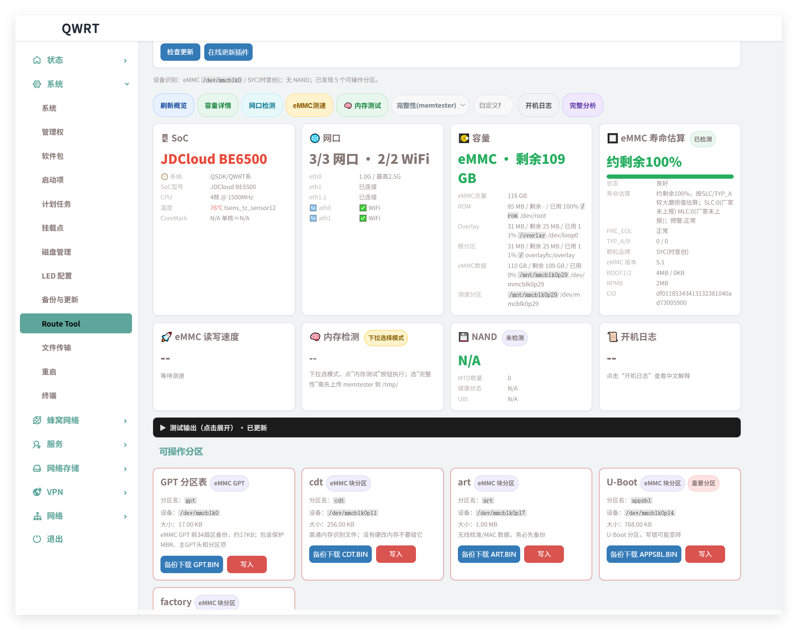

# route-tool

OpenWrt LuCI 路由分区工具：在同一个页面备份/写入关键分区。



- 高通 eMMC：GPT 分区表、cdt、art、appsbl、factory、mibib（部分机型没有）
- MTK：BL2、fip、factory；如果是 eMMC 机型也显示 GPT 分区表
- 其他非 eMMC 设备：不显示 GPT，只按实际 MTD 分区显示
- 备份按钮直接下载：`分区名.bin`
- 写入自动区分：eMMC 块设备用 `dd`，NAND 用 `flash_erase + nandwrite`，NOR/MTD 优先用 `mtd write`
- Swap / ext4 存储管理：自动按内存匹配 swap 容量、格式化内置 swap 分区、一键建 ext4 存储分区
- UI：系统 / Route Tool
- footer：by 数码罗记 · godsun.pro

## 安装

从 GitHub Releases 下载最新 IPK：

```sh
wget -O /tmp/luci-app-route-tool.ipk https://github.com/rothdren-lion/luci-app-route-tool/releases/latest/download/luci-app-route-tool_all.ipk
opkg install /tmp/luci-app-route-tool.ipk
```

### opkg 报错 Malformed package file？

部分第三方固件（QWRT 等）的 BusyBox 精简了 `ar` applet，导致旧版 opkg 无法解析 ar 格式的 ipk。如果 `opkg install` 报 `Malformed package file`，用手动安装：

```sh
cd /tmp
wget -O luci-app-route-tool.ipk https://github.com/rothdren-lion/luci-app-route-tool/releases/latest/download/luci-app-route-tool_all.ipk
# 解包 ipk（ar 归档 = debian-binary + control.tar.gz + data.tar.gz）
tar -xzf luci-app-route-tool.ipk 2>/dev/null || ar x luci-app-route-tool.ipk
# 安装文件到系统
tar -xzf data.tar.gz -C /
# 注册到 opkg（让 opkg info 能看到，方便后续卸载/升级）
mkdir -p /usr/lib/opkg/info
tar -xzf control.tar.gz -C /usr/lib/opkg/info/
# 清理
rm -f debian-binary control.tar.gz data.tar.gz luci-app-route-tool.ipk
# 刷新 LuCI 缓存
rm -rf /tmp/luci-*
/etc/init.d/uhttpd restart
```

> **说明**：ipk 本身是标准 ar 归档格式，格式没有问题。问题出在固件端 BusyBox 缺少 `ar` 解包能力。OpenWrt 官方固件不受影响。

安装后页面标题版本号旁会每天自动检查一次 GitHub Releases；发现新版本时显示 `可更新` 小标识，点击即可在线 OTA 更新插件。

也可以从源码安装：

```sh
sh install.sh
```

## 可选依赖

- GPT 备份/恢复需要 `sgdisk`：`opkg install gdisk`
- NAND 写入需要 `flash_erase` / `nandwrite`，通常来自 `mtd-utils`
- Swap / ext4 功能需要 `mkswap`(busybox 自带)、`swapon`(fstools 自带)、`mkfs.ext4`(e2fsprogs)
- 分区检测优先用 `lsblk`(util-linux) 读取 GPT 类型码，缺失时自动回退到 `sgdisk` / sysfs

## Swap 与 ext4 存储分区（v0.3.34 新增）

页面底部新增「🧩 Swap 交换管理」：

- **自动匹配容量**：读取 `/proc/meminfo` 的物理内存，按 1:1（上限 1GB）给出建议值
  - ≤256MB → 512MB；≤512MB → 512MB；≤768MB → 768MB；≤1GB → 1024MB
  - \>1GB → 建议关闭 swap
- **最低 / 自定义**：最低 64MB，也可手动输入任意 MB
- **复用内置 swap 分区**：很多路由器的 GPT 里本来就带一个 swap 分区（常常没格式化）。
  插件会自动识别它（GPT 类型码 `8200` / 分区名含 swap / `blkid` 识别为 swap）：
  - 没格式化 → `mkswap` 后启用
  - 已格式化但没启用 → 直接启用
  - 已启用 → 只补 `/etc/config/fstab` 条目
  - 容量比建议值小且未格式化 → 删掉重建为建议容量
- **一键 Swap + ext4**：先处理 swap，再把 eMMC 尾部空闲空间建成 `storage` ext4 分区并挂载到 `/mnt/`
- **开机自动生效**：swap 与 ext4 都会写进 `/etc/config/fstab`，由 fstools 的
  `/etc/init.d/fstab` 在开机时自动 `swapon` / `mount`
- **提示**：eMMC swap 会加速闪存磨损；小内存机器更适合 zram（`apk add kmod-zram zram-swap`）

## 后端命令

```sh
/usr/libexec/route-tool list
/usr/libexec/route-tool backup appsbl > /tmp/appsbl.bin
/usr/libexec/route-tool write appsbl /tmp/uboot.bin YES
/usr/libexec/route-tool alloc_storage            # 预览
/usr/libexec/route-tool alloc_storage YES        # 新建 ext4 storage 分区
/usr/libexec/route-tool swap_info                # JSON：内存 / swap / 建议值
/usr/libexec/route-tool swap_plan auto 0 1       # 预览（auto|min|custom，容量，附带ext4）
/usr/libexec/route-tool swap_create auto 0 1 YES  # 一键 swap + ext4
/usr/libexec/route-tool swap_disable YES         # 停用 swap（保留分区）
/usr/libexec/route-tool swap_delete YES          # 删除 swap 分区
```

## 自检脚本

```sh
sh tests/check-swap-helpers.sh      # swap/GPT 辅助函数的单元检查（任意 Linux 主机可跑）
```
